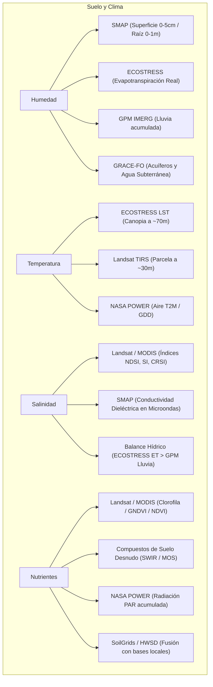

# Guía Técnica: Adaptación Agrícola con Datos de la NASA
## Reto Space Apps: *Field Shift: Adapting Farms with NASA Data*

Este documento detalla cómo los conjuntos de datos de observación terrestre de la NASA (**SMAP, ECOSTRESS, GPM, Landsat, MODIS, NASA POWER, GRACE/GRACE-FO**) responden a las cuatro variables críticas de manejo agronómico: **Humedad**, **Temperatura**, **Salinidad** y **Nutrientes**, desglosando los fundamentos biofísicos y matemáticos detrás de cada medición.

---

## 1. Clasificación General de Disponibilidad de Datos

| Variable | Tipo de Detección | Datasets Clave | Resolución Espacial Típica |
| :--- | :--- | :--- | :--- |
| **Humedad del Suelo / Estrés Hídrico** | **Directa y Asimilada** | SMAP, ECOSTRESS, GPM, NASA POWER | 70 m (ECOSTRESS) a 9–36 km (SMAP) |
| **Temperatura (Canopia, Suelo, Aire)** | **Directa** | ECOSTRESS, Landsat, MODIS, NASA POWER | 30–70 m (Térmica óptica) a 0.5° (POWER) |
| **Salinidad del Suelo** | **Indirecta / Proxy Espectral y Dieléctrico** | Landsat, MODIS, SMAP, ECOSTRESS + GPM | 30 m (Índices) / Balance hídrico |
| **Nutrientes (N, P, K, MOS, SOC)** | **Indirecta / Proxy Fisiológico y DSM** | Landsat, MODIS, GPM + SMAP + SoilGrids | 30 m (Vigor/Clorofila) / Modelos ML |

---

## 2. Análisis por Variable Agronómica

### A. Humedad y Dinámica Hídrica
* **SMAP (Soil Moisture Active Passive):**
  * *Humedad superficial (0–5 cm):* Medida mediante radiometría en banda L (1.41 GHz). Sensible al contenido volumétrico de agua ($cm^3/cm^3$).
  * *Humedad en zona radicular (RZSM, 0–100 cm):* Nivel L4 (`SPL4SMAU`). Se obtiene asimilando observaciones de brillo radiométrico de SMAP dentro del modelo de superficie terrestre Catchment Land Surface Model (CLSM).
* **ECOSTRESS (en la Estación Espacial Internacional):**
  * *Evapotranspiración Real (ET):* Basada en el algoritmo PT-JPL (Priestley-Taylor Jet Propulsion Laboratory).
  * *Índice de Estrés Evaporativo (ESI):* Relación entre la evapotranspiración real y la potencial ($\text{ET}/\text{PET}$). Detecta deshidratación antes del marchitamiento visual.
  * *Eficiencia en el Uso del Agua (WUE):* Relación entre el carbono asimilado y el agua transpirada.
* **GPM (Global Precipitation Measurement):**
  * *Precipitación Global (IMERG):* Fusión de múltiples satélites pasivos de microondas y radar. Registra intensidad y acumulación de lluvia cada 30 minutos a 0.1° (~10 km).
* **NASA POWER:**
  * Humedad Relativa a 2 metros (`RH2M`), Humedad Específica (`QV2M`) y Punto de Rocío (`T2MDEW`).
* **GRACE / GRACE-FO:**
  * Anomalías en el Almacenamiento Terrestre de Agua (**TWS - Terrestrial Water Storage**) y reservas de agua subterránea profunda (acuíferos).

---

### B. Temperatura
* **ECOSTRESS (Canopia a escala submétrica):**
  * Temperatura de la Superficie Terrestre (LST) a ~70 m de resolución con el sensor térmico multicanal (TIR). Captura la variación diurna en distintos horarios solares.
* **Landsat 8 / 9 (Sensor TIRS / TIRS-2):**
  * Bandas térmicas (Bandas 10 y 11) remuestreadas a 30 metros. Permite identificar anomalías térmicas y microclimas a nivel de lote o parcela agrícola.
* **MODIS (Terra y Aqua):**
  * Productos `MOD11A1` y `MYD11A1`: LST diaria (día y noche) a 1 km con un registro histórico continuo desde el año 2000.
* **NASA POWER (Temperatura del Aire):**
  * Parámetros a 2 metros: `T2M` (media), `T2M_MAX` (máxima), `T2M_MIN` (mínima). Imprescindible para el cómputo de fenología y horas frío.

---

### C. Salinidad del Suelo
> [!NOTE]
> Los satélites no miden directamente los miligramos de sales disueltas ($NaCl, CaSO_4, MgSO_4$) por kilogramo de suelo. La salinidad se determina mediante tres vías indirectas:

1. **Índices de Salinidad en Suelo Desnudo (Landsat & MODIS):**
   Las costras salinas formadas por evaporación incrementan la reflectancia en las bandas del visible e Infrarrojo de Onda Corta (SWIR):
   $$\text{NDSI (Normalized Difference Salinity Index)} = \frac{R - NIR}{R + NIR}$$
   $$\text{SI (Salinity Index)} = \sqrt{B \times R}$$
   $$\text{SI}_3 = \sqrt{G^2 + R^2 + NIR^2}$$
2. **Índices de Respuesta de la Vegetación a la Salinidad (CRSI):**
   $$\text{CRSI} = \sqrt{\frac{(NIR \times R) - (G \times B)}{(NIR \times R) + (G \times B)}}$$
   Cuantifica el daño celular y la reducción de clorofila provocados por toxicidad iónica y presión osmótica salina.
3. **Modelado de Riesgo por Balance Hídrico:**
   La salinización secundaria ocurre cuando la Evapotranspiración ($\text{ET}_{\text{ECOSTRESS}}$) supera sistemáticamente la Precipitación ($\text{P}_{\text{GPM}}$) en zonas con agua subterránea superficial o riego deficiente.

---

### D. Nutrientes del Suelo y Estado Nutricional
> [!IMPORTANT]
> Ningún sensor satelital óptico convencional penetra el subsuelo para medir Nitrógeno (N), Fósforo (P) o Potasio (K) elemental. Sin embargo, se monitorean eficazmente mediante:

* **Nitrógeno Foliar (Proxy de Clorofila):**
  El 70% del nitrógeno en las hojas de los cultivos está contenido en las enzimas fotosintéticas (Rubisco y clorofila). Se monitorea mediante:
  $$\text{NDVI} = \frac{NIR - Red}{NIR + Red} \quad\text{y}\quad \text{GNDVI (Green NDVI)} = \frac{NIR - Green}{NIR + Green}$$
  Un descenso en GNDVI o NDVI durante periodos con humedad óptima indica deficiencia nutricional nitrogenada.
* **Materia Orgánica y Carbono Orgánico del Suelo (MOS / SOC):**
  En ventanas de suelo arado (suelo desnudo), las bandas SWIR de Landsat (Banda 6 y 7) y MODIS se correlacionan inversamente con el contenido de materia orgánica del suelo.
* **Lixiviación y Movilidad de Nutrientes (GPM + SMAP):**
  Eventos extremos de precipitación (GPM) sobre suelos en punto de saturación (SMAP) desencadenan la lixiviación de nitratos hacia capas profundas o escorrentía superficial.
* **Radiación Fotosintéticamente Activa (PAR - NASA POWER):**
  El parámetro `ALLSKY_SFC_PAR_TOT` suministra los megajulios de luz asimilable por metro cuadrado, permitiendo modelar la tasa de extracción de nutrientes según biomasa potencial.

---

## 3. Explicación Detallada de Conceptos Complejos

### 1. ¿Por qué un satélite no puede "oler" o medir químicamente los iones de N-P-K?
La teledetección óptica y térmica mide la **reflectancia y emitancia electromagnética** de la superficie expuesta. 
* Los iones como $NO_3^-$ (nitrato), $NH_4^+$ (amonio) y $K^+$ (potasio) existen disueltos en la solución del suelo a nivel micromolar y no poseen bandas de absorción espectral discretas, estrechas y exclusivas en el rango visible o infrarrojo que no queden completamente enmascaradas por el agua y los minerales de arcilla.
* Por ello, el estándar agronómico espacial utiliza **modelos indirectos**: 
  $$\text{Nutrientes} \approx f(\text{Vigor del cultivo}, \text{Materia orgánica en suelo desnudo}, \text{Humedad}, \text{Tipo de suelo})$$

---

### 2. Constante Dieléctrica del Suelo y la Banda L de SMAP
* **La física:** La permitividad dieléctrica relativa ($\varepsilon$) describe la capacidad de un material de polarizarse en respuesta a un campo electromagnético.
  * Suelo seco: $\varepsilon \approx 3 \text{ a } 5$
  * Agua líquida pura: $\varepsilon \approx 80$
* Como la diferencia entre 3 y 80 es tan grande, cuando el suelo absorbe humedad, la permitividad total se dispara. El radiómetro en banda L de SMAP detecta este cambio midiendo la **temperatura de brillo radiométrica** ($T_B = e \cdot T_{\text{física}}$).
* **El efecto de la salinidad:** Los iones salinos incrementan la conductividad eléctrica del agua del suelo ($\sigma$), lo cual añade una componente imaginaria al valor dieléctrico:
  $$\varepsilon^* = \varepsilon' - j \left(\varepsilon'' + \frac{\sigma}{\omega \varepsilon_0}\right)$$
  Esto distorsiona la emisión de microondas, permitiendo que anomalías dieléctricas persistentes sirvan como bioindicador de acumulación salina en zonas áridas.

---

### 3. Temperatura de Superficie (LST) vs. Temperatura del Aire (T2M)
Una confusión frecuente en agrotecnología es tratar la temperatura ambiente como equivalente a la temperatura del cultivo:
* **Temperatura del Aire ($T_{\text{aire}}$ / `T2M` de NASA POWER):** Mide la energía cinética de las moléculas de gas a 2 metros del suelo protegidas de la radiación directa.
* **Temperatura de Superficie Terrestre (LST / ECOSTRESS y Landsat):** Mide la radiación infrarroja térmica emitida por las hojas de la canopia vegetal según la ley de Stefan-Boltzmann:
  $$j^* = \varepsilon \sigma T^4$$
* **El mecanismo de transpiración:** Al igual que los seres vivos transpiran para enfriarse, las plantas transpiran vapor de agua a través de los estomas.
  * *Planta sana con agua suficiente:* Transpira activamente $\rightarrow$ Su temperatura de canopia es entre **2 °C y 6 °C más fría** que el aire circundante.
  * *Estrés hídrico o salino:* Los estomas se cierran para no perder agua $\rightarrow$ La transpiración se detiene $\rightarrow$ La radiación solar calienta las hojas $\rightarrow$ La canopia se vuelve **más caliente** que el aire circundante.
  * **ECOSTRESS detecta este aumento de calor antes de que la clorofila se degrade.**

---

### 4. Gravimetría Satelital: Cómo GRACE "pesa" el agua subterránea
Los satélites convencionales no pueden penetrar decenas o cientos de metros bajo tierra. La misión **GRACE** y **GRACE-FO** utiliza una técnica basada en la gravedad:
1. Dos satélites idénticos vuelan en la misma órbita separados por ~220 km.
2. Un sistema láser mide variaciones micrométricas en la distancia entre ambos satélites.
3. Cuando el satélite líder pasa sobre una región con mayor masa (por ejemplo, un acuífero lleno), la gravedad local lo atrae hacia adelante, cambiando la distancia relativa.
4. Al restar la masa de la atmósfera y la topografía fija, la variación restante corresponde exactamente al **movimiento de masas de agua** (agotamiento o recarga de acuíferos).

---

### 5. Grados Día de Crecimiento (GDD - Growing Degree Days)
Métrica utilizada para predecir cuándo florecerá, madurará o requerirá fertilizante un cultivo, calculada mediante las temperaturas de **NASA POWER**:

$$\text{GDD} = \max\left(\frac{T_{\text{max}} + T_{\text{min}}}{2} - T_{\text{base}},\, 0\right)$$

*Donde $T_{\text{base}}$ es la temperatura umbral biológica bajo la cual el cultivo no se desarrolla (ej. 10 °C para maíz, 4 °C para trigo).* Permite a la herramienta recomendar fechas de siembra resilientes a temporadas atípicas.

---

## 4. Matriz de Síntesis: De la Variable al Sensor

---

## 5. Recomendación de Arquitectura para el Proyecto

Para construir la solución de toma de decisiones en el desafío **Field Shift**:

1. **Capa Dinámica Satelital (NASA):**
   * Usar la **API de NASA POWER** (`https://power.larc.nasa.gov/api/temporal/daily/point`) para consultar en tiempo real radiación solar (`ALLSKY_SFC_SW_DWN`), temperatura (`T2M`) y precipitación (`PRECTOTCORR`).
   * Usar colecciones de **Google Earth Engine (GEE)** o **NASA AppEEARS** para extraer índices históricos de parcelas agrícolas:
     * `NASA_USDA/HSL/SMAP10KM_soil_moisture` para humedad radicular.
     * `LANDSAT/LC09/C02/T1_L2` para temperatura superficial y cálculo de NDSI / GNDVI.
     * `ECOSTRESS` para alertas tempranas de estrés evaporativo.
2. **Capa Estática de Suelo (Fusión de Datos):**
   * Integrar la API de **SoilGrids (ISRIC)** o **HWSD** para obtener la textura básica del suelo (% arcilla, limo, arena), el pH inicial y la Capacidad de Intercambio Catiónico (CIC).
3. **Módulo de Toma de Decisiones:**
   * Si la salinidad aumenta ($\text{NDSI}$ alto y $\text{ET} > \text{Lluvia}$): Recomendar cultivos halófilos o tolerantes (cebada, sorgo, remolacha) e indicar necesidad de lavado de sales.
   * Si el estrés hídrico es crítico ($\text{ESI} < 0.4$ y SMAP bajo): Recomendar rotación hacia variedades de ciclo corto o resistentes a sequía (leguminosas autóctonas).
   * Si el vigor/nitrógeno cae ($\text{GNDVI}$ bajo con humedad normal): Alertar sobre agotamiento de nutrientes y sugerir siembra de abonos verdes fijadores de nitrógeno (alfalfa, trébol).
